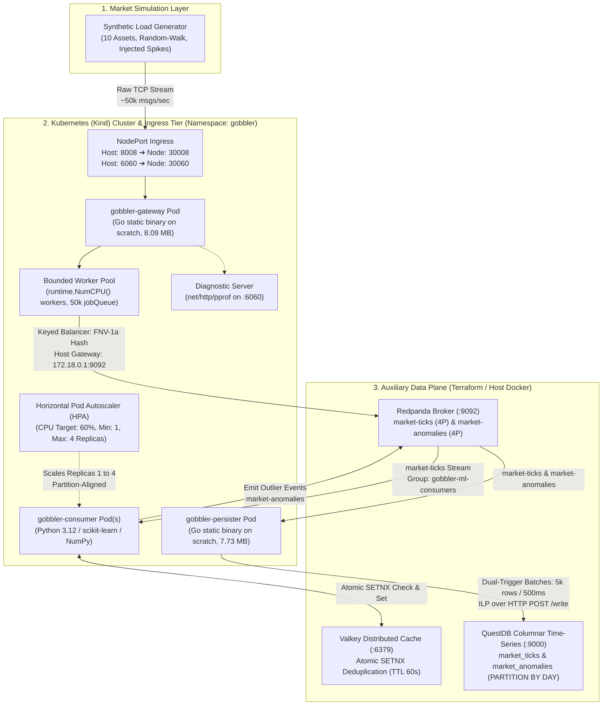

# Gobbler: Real-Time Financial Market Surveillance & Anomaly Detection Platform

Gobbler is a high-throughput, distributed market surveillance and streaming analytics platform. It ingests simulated high-frequency financial exchange order flow via a low-latency network gateway, decouples streams using an event broker, processes trade data for statistical price anomalies, and stores time-series data for forensic analysis.




---

## Current Architecture & Status

### Phase 1: Ingestion Gateway & Go Concurrency (✅ Completed)
* **High-Throughput TCP Server**: Non-blocking connection accept loop listening on port `8008`.
* **Bounded Concurrency**: Dedicated bounded queue channel (`50,000` capacity) feeding a CPU-scaled worker pool (`runtime.NumCPU()` workers).
* **Buffer Safety**: Solves `bufio.Scanner` buffer recycling gotchas via clean byte copying.
* **Production Lifecycle**: Intercepts OS signals (`SIGINT`, `SIGTERM`), tears down active sockets, and drains in-flight items without data loss.
* **Observability**: Embedded real-time throughput reporter and live `pprof` diagnostic server on port `6060`.

### Phase 2: Event Streaming & Decoupled Architecture (✅ Completed)
* **Broker Foundation**: Single-node Redpanda cluster running in Docker (`docker-compose.yml`) using ephemeral development storage.
* **Pure Go Producer**: Integrated `segmentio/kafka-go` (100% pure Go, zero Cgo overhead, multi-arch friendly for ARM64/Raspberry Pi).
* **Keyed Partitioning**: Explicit hashing balancer (`&kafka.Hash{}`) using 10 asset tickers as partition keys, guaranteeing strict per-asset FIFO ordering across the 4 topic partitions.
* **Zero-Allocation Forwarding**: Direct reuse of validated raw byte payloads, bypassing re-marshaling and eliminating garbage collector pressure.
* **Failure Resilience & Backpressure**: Self-healing exponential backoff (`dispatchMsg`) that blocks worker routines on broker outages, safely propagating backpressure upstream to the TCP socket without dropping ticks or exceeding memory bounds.
* **Chaos Engineering Verified**: 192,754 / 192,754 ticks delivered during live mid-stream broker freeze tests with 100.000% data integrity.

### Phase 3: Stream Inference, Anomaly Detection & Distributed Caching (✅ Completed)
* **Distributed Idempotency**: Valkey (Redis-compatible) cache on port `6379`. Each tick is deduplicated via an atomic `SET tick:<ticker>:<timestamp_ns> seen EX 60 NX` before reaching the inference layer, providing effectively-once processing across horizontally scaled consumer pods.
* **Consumer Group Parallelism**: Python worker (`consumer/consumer.py`) subscribes via `confluent-kafka` with `enable.auto.commit=False`, committing offsets explicitly only after deduplication and inference. Graceful `LeaveGroup` on `SIGINT`/`SIGTERM` triggers immediate partition rebalancing.
* **Two-Tier Anomaly Detector** (`consumer/detector.py`):
  * **Tier 1 — Statistical (sub-0.1ms)**: Per-ticker `deque`-backed rolling window of `(price, volume)` tuples. Z-score Dual-Condition Guard: `|Z| > 3.0` AND `pct_change >= 2%`. Catches sharp univariate price shocks (flash crashes, pumps).
  * **Tier 2 — ML (sub-2ms)**: `IsolationForest(n_estimators=50)` fitted on normalized `[z_price, z_volume]` features from the rolling window, re-fitted every 100 ticks. Uses `score_samples` threshold (`< -0.65`) to avoid the Contamination Trap. Catches multivariate co-movement anomalies (e.g., volume-only spikes with no price shock).
  * **Detection Logic**: `is_anomaly = tier1_anomaly or (ml_score < -0.65)` — independent OR, either tier can fire without the other.

### Phase 4: Time-Series Persistence & Infrastructure-as-Code (✅ Completed)
* **High-Throughput Time-Series Database**: QuestDB integrated via Docker Compose (`docker-compose.yml`) and OpenTofu (`infra/`) exposing ILP (`:9000` HTTP, `:9009` TCP) and PGWire (`:8812`) with daily partitioned columnar storage for `market_ticks` and `market_anomalies`.
* **Decoupled Go Persister Service**: Streaming persistence worker (`persister/persister.go`) consuming ticks and anomaly alerts with dual-trigger batching (5,000 rows or 500ms) and post-flush consumer offset commits.
* **Production Containerization**: Multi-stage Dockerfiles for all microservices (`Dockerfile.gateway`, `Dockerfile.generator`, `Dockerfile.persister`, `Dockerfile.consumer`). Pure Go services compile to 100% static binaries on `scratch` (~2.5MB–8MB) and Python ML worker on `python:3.12-slim` (~413MB), all running as unprivileged user `appuser` (UID 10001).
* **Declarative Infrastructure-as-Code (OpenTofu / Terraform)**: Codified auxiliary streaming backbone (`infra/auxiliary.tf`) on custom bridge network (`gobbler-network`), persistent volume (`questdb_data`), dual-listener Kafka networking (`internal` vs `external`), and modular Option C microservices toggle (`infra/workloads.tf`).
* **Local Kubernetes (Kind) Orchestration & Autoscaling**: Multi-node Kind cluster (`k8s/kind-config.yaml`) with 1 control plane and 2 workers. Ingestion Gateway exposed via NodePort `30008` (ticks) and `30060` (pprof). Horizontal Pod Autoscaler (HPA) dynamically scaling the Python ML Consumer tier from 1 to 4 replicas (strictly partition-aligned to topic `market-ticks`), verified live with 133k+ ticks persisted and zero lag.

---

## Repository Structure

```text
├── AGENTS.md                    # Agent persona rules (Socratic coding tutor)
├── .dockerignore                # Build context filtering (excludes venv, pycache, git, logs)
├── Dockerfile.consumer          # Python ML worker: multi-stage python:3.12-slim (/opt/venv -> non-root)
├── Dockerfile.gateway           # TCP Gateway: multi-stage golang:1.25-alpine -> scratch (8.09MB)
├── Dockerfile.generator         # Mock Generator: multi-stage golang:1.25-alpine -> scratch (2.57MB)
├── Dockerfile.persister         # ILP Persister: multi-stage golang:1.25-alpine -> scratch (7.73MB)
├── consumer/
│   ├── .venv/                   # Isolated Python virtual environment (uv-managed, git-ignored)
│   ├── consumer.py              # Kafka consumer worker: dedup, inference loop, manual commits
│   ├── detector.py              # Two-tier anomaly detector: Z-Score (Tier 1) + IsolationForest (Tier 2)
│   └── requirements.txt         # Python dependencies (confluent-kafka, redis, numpy, scikit-learn)
├── docker-compose.yml           # Redpanda, Valkey & QuestDB container service definitions
├── docs/
│   ├── context.md               # Continuous architecture state for pair-programming agents
│   ├── kubernetes.md            # Kubernetes & Kind orchestration guide, primitives & HPA
│   ├── mlinferencing.md         # Study guide: rolling windows, Z-score, IsolationForest math
│   ├── plan.md                  # Interactive project roadmap, milestones & definitions of done
│   ├── questdb.md               # Deep-dive architecture reference, ILP guide & SQL reference for QuestDB
│   ├── redpanda.md              # Deep-dive architecture reference & CLI guide for Redpanda
│   ├── terraform.md             # Terraform & OpenTofu concepts, Docker provider & CLI guide
│   └── valkey.md                # Valkey concepts, Idempotent Consumer pattern & CLI guide
├── generator/
│   └── generator.go             # Standalone synthetic market load generator (10 B3 assets)
├── go.mod                       # Go module definitions
├── go.sum                       # Checksums for external dependencies
├── infra/                       # Declarative OpenTofu / Terraform IaC manifests
│   ├── auxiliary.tf             # Redpanda, Valkey & QuestDB container and volume definitions
│   ├── main.tf                  # Provider configuration (kreuzwerker/docker >= 3.0.2)
│   ├── outputs.tf               # Exported endpoints (Kafka, Valkey, QuestDB, Gateway)
│   ├── variables.tf             # Parameterized ports, images and Option C toggle
│   ├── versions.tf              # Provider version locks and OpenTofu requirements
│   └── workloads.tf             # Option C microservice containers (gateway, consumer, persister)
├── k8s/                         # Kubernetes declarative manifests for Kind
│   ├── 00-namespace.yaml        # Dedicated 'gobbler' namespace boundary
│   ├── 01-configmap.yaml        # Centralized 12-factor configuration (172.18.0.1 bridge routing)
│   ├── 02-gateway.yaml          # Ingestion Gateway Deployment & NodePort Service (30008, 30060)
│   ├── 03-persister.yaml        # QuestDB ILP Persister Deployment (pure consumer, no Service)
│   ├── 04-consumer.yaml         # Python ML Inference Deployment (CPU requests for HPA)
│   ├── 05-hpa.yaml              # Horizontal Pod Autoscaler (1 to 4 replicas, 60% CPU target)
│   └── kind-config.yaml         # Multi-node Kind cluster definition (1 control-plane, 2 workers)
├── main.go                      # Core Ingestion Gateway, TCP server & Kafka producer
├── persister/
│   └── persister.go             # High-throughput ILP persistence worker (Kafka -> QuestDB)
└── README.md                    # Project documentation
```

---

## Quickstart & Execution Runbook

Gobbler supports two execution and verification workflows:
1. **Track A: Kubernetes (Kind) Multi-Node Cluster (Recommended / Production Target)**: Full containerized deployment showcasing microservices on `scratch`, NodePort ingress routing, 12-factor ConfigMaps, and automated Horizontal Pod Autoscaling (HPA).
2. **Track B: Local Host Developer Fast-Loop**: Provisions auxiliary streaming backends in Docker while running Go/Python binaries natively on the host for rapid sub-second code iteration.

---

### Track A: Kubernetes (Kind) Orchestration & Autoscaling (Primary)

#### 1. Prerequisites
* [Go 1.22+](https://golang.org/)
* [Docker](https://www.docker.com/) (Engine / Desktop)
* [Kind (Kubernetes in Docker)](https://kind.sigs.k8s.io/)
* [kubectl](https://kubernetes.io/docs/tasks/tools/)
* [OpenTofu](https://opentofu.org/) or [Terraform](https://www.terraform.io/) (>= 1.6)

#### 2. Provision Auxiliary Data Plane via OpenTofu / Terraform
Deploy Redpanda (Kafka API on `:9092`), Valkey (cache on `:6379`), and QuestDB (time-series database on `:9000`) on a dedicated Docker bridge network (`gobbler-network`):
```bash
cd infra && terraform apply -auto-approve && cd ..
```
Verify data plane health:
```bash
docker exec redpanda rpk cluster info
docker exec valkey valkey-cli ping
```

#### 3. Initialize Kafka Topics & QuestDB Tables
Create 4-partition topics aligned with our HPA scaling bounds:
```bash
docker exec redpanda rpk topic create market-ticks --partitions 4
docker exec redpanda rpk topic create market-anomalies --partitions 4
```
Initialize daily-partitioned analytical tables in QuestDB via its SQL REST API:
```bash
curl -s -G --data-urlencode "query=CREATE TABLE IF NOT EXISTS market_ticks (ticker SYMBOL CAPACITY 16 CACHE, price DOUBLE, volume LONG, timestamp TIMESTAMP) TIMESTAMP(timestamp) PARTITION BY DAY;" http://localhost:9000/exec
curl -s -G --data-urlencode "query=CREATE TABLE IF NOT EXISTS market_anomalies (ticker SYMBOL CAPACITY 16 CACHE, price DOUBLE, volume LONG, z_score DOUBLE, anomaly_tier SYMBOL CAPACITY 16 CACHE, timestamp TIMESTAMP) TIMESTAMP(timestamp) PARTITION BY DAY;" http://localhost:9000/exec
```

#### 4. Spin Up the Multi-Node Kind Cluster
Create the 3-node Kind cluster (1 control-plane with `extraPortMappings` for `8008` and `6060`, 2 workers):
```bash
kind create cluster --config k8s/kind-config.yaml
```

Sideload locally-built container images into the Kind node container runtime (`containerd`):
```bash
# Note: On snap-confined Docker hosts, prefix with TMPDIR=~/tmp
TMPDIR=~/tmp kind load docker-image gobbler-gateway:latest gobbler-persister:latest gobbler-consumer:latest --name gobbler-cluster
```

#### 5. Deploy Workloads & Monitor Autoscaling
Apply all Kubernetes manifests (Namespace, ConfigMap, Deployments, NodePort Service, and HPA):
```bash
kubectl apply -f k8s/0*.yaml
```
Verify pods are running across worker nodes:
```bash
kubectl get pods -n gobbler -o wide
```

#### 6. Stream Financial Order Flow & Observe Live Autoscaling
Open two terminal windows:

* **Terminal 1 (Autoscaling Monitor)**:
  ```bash
  kubectl get hpa -n gobbler -w
  ```
* **Terminal 2 (Load Generator)**:
  Stream high-throughput synthetic ticks to the Ingestion Gateway via NodePort port `8008`:
  ```bash
  go run generator/generator.go
  ```

**What you will observe**:
1. Order flow pours into `gobbler-gateway` at ~50k msgs/sec and dispatches into Redpanda's 4 partitions.
2. The Python ML Consumer CPU surges past the 60% threshold (~500% load against base `100m` request).
3. The **Horizontal Pod Autoscaler (HPA)** scales the consumer tier from **1 to 4 replicas**, perfectly assigning 1 pod per Kafka partition without partition lock contention.
4. Once generation ceases, consumers process the backlog down to `TOTAL-LAG: 0`, and the HPA automatically scales back down to **1 replica** after the 60s stabilization window.

#### 7. Query Real-Time Time-Series Analytics
Query QuestDB to inspect persisted ticks and confirmed anomaly alerts:
```bash
# Total ticks ingested via zero-copy ILP:
curl -G "http://localhost:9000/exec" --data-urlencode "query=SELECT count(*) FROM market_ticks;"

# Total anomalies detected:
curl -G "http://localhost:9000/exec" --data-urlencode "query=SELECT count(*) FROM market_anomalies;"

# Forensic ASOF JOIN linking anomaly alerts with prevailing tick prices:
curl -G "http://localhost:9000/exec" --data-urlencode "query=SELECT a.timestamp, a.ticker, a.anomaly_tier, a.z_score, t.price FROM market_anomalies a ASOF JOIN market_ticks t ON (ticker) LIMIT 10;"
```

#### 8. Cluster & Infrastructure Teardown
```bash
kind delete cluster --name gobbler-cluster
cd infra && terraform destroy -auto-approve && cd ..
```

---

### Track B: Local Host Developer Fast-Loop (Standalone Mode)

For sub-second code editing and local debugging without running Kubernetes:

1. **Start Auxiliary Services**:
   ```bash
   cd infra && terraform apply -auto-approve && cd ..
   # Or via docker compose: docker compose up -d
   ```
2. **Terminal 1 — Ingestion Gateway**:
   ```bash
   go run main.go
   ```
3. **Terminal 2 — Time-Series Persister**:
   ```bash
   go run persister/persister.go
   ```
4. **Terminal 3 — Python ML Worker**:
   ```bash
   cd consumer && uv venv .venv && source .venv/bin/activate
   uv pip install -r requirements.txt
   PYTHONUNBUFFERED=1 python consumer.py
   ```
5. **Terminal 4 — Synthetic Load Generator**:
   ```bash
   go run generator/generator.go
   ```

---

## Failure & Chaos Testing

To test system resilience against broker failure:

1. While the generator and gateway are actively streaming, pause the broker:
   ```bash
   docker pause redpanda
   ```
2. **Observe**: The gateway logs warning retries (`context deadline exceeded. Retrying in 50ms...`), buffers up to 50,000 items in `jobQueue`, and backpressures the generator socket. Memory usage remains constant.
3. Unpause the broker:
   ```bash
   docker unpause redpanda
   ```
4. **Observe**: The gateway immediately reconnects, flushes all pending batches to Redpanda, and resumes streaming without data loss.

---

## Performance Profiling with `pprof`

The Ingestion Gateway exposes a live diagnostic endpoint on `http://127.0.0.1:6060/debug/pprof/` powered by the standard library's `net/http/pprof`. This enables real-time CPU, memory, and goroutine profiling while streaming high-throughput tick data.

### 1. Web-Based Visual Profiler (Flame Graphs & Call Graphs)
Launch an interactive web dashboard (requires [Graphviz](https://graphviz.org/) for graph rendering):

* **CPU Profiling (30-second capture with Flame Graph)**:
  ```bash
  go tool pprof -http=:8081 http://127.0.0.1:6060/debug/pprof/profile?seconds=30
  ```
* **Heap Memory Profiling (Live Allocations)**:
  ```bash
  go tool pprof -http=:8081 http://127.0.0.1:6060/debug/pprof/heap
  ```
Navigate to `http://localhost:8081` in your browser to view Top lists, Call Graphs, and Flame Graphs.

### 2. Interactive Terminal CLI Profiling
Inspect hotspots directly in your terminal:

* **Analyze CPU Hotspots**:
  ```bash
  go tool pprof http://127.0.0.1:6060/debug/pprof/profile?seconds=15
  ```
  Useful interactive commands inside the pprof shell:
  * `top 10`: Display the top 10 CPU-consuming functions.
  * `list worker`: Disassemble and inspect per-line CPU time inside the `worker` function.
  * `web`: Export and open a SVG call graph in your default browser.

* **Analyze Heap Allocations (Preparing for `sync.Pool` Optimization)**:
  ```bash
  # Inspect total allocations over time (cumulative heap stress):
  go tool pprof -alloc_space http://127.0.0.1:6060/debug/pprof/heap

  # Inspect current live in-memory objects:
  go tool pprof -inuse_space http://127.0.0.1:6060/debug/pprof/heap
  ```

* **Goroutine Leak Detection**:
  ```bash
  go tool pprof http://127.0.0.1:6060/debug/pprof/goroutine
  ```
  Verify that the worker pool and connection handlers terminate cleanly and do not leak routines over long simulation runs.

### 3. Quick Browser Inspection
Visit `http://127.0.0.1:6060/debug/pprof/` in any browser while `main.go` is running to view raw counts of active goroutines, heap allocations, thread creation events, and mutex contention blocks.

