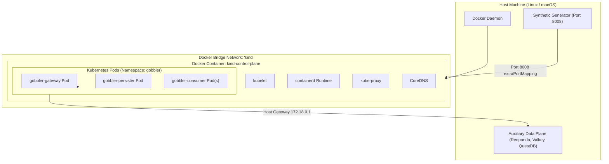
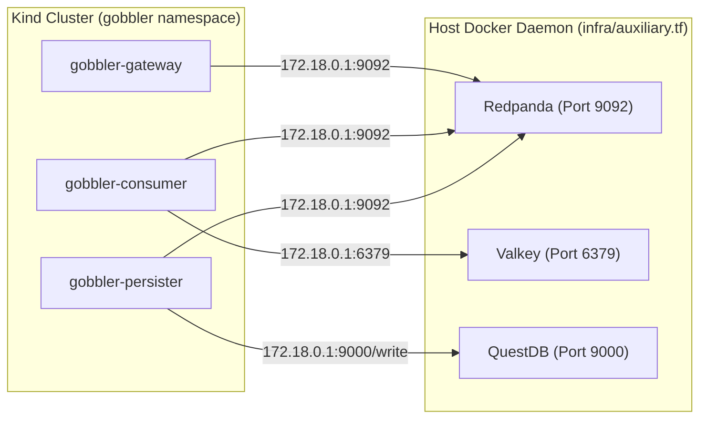

# Kubernetes & Kind Orchestration Guide

This document explains the concepts, operational mechanics, and architectural design for running Gobbler's distributed microservices inside a local **Kubernetes (Kind)** cluster.

---

## 1. What is Kubernetes?

**Kubernetes (K8s)** is an open-source container orchestration platform designed to automate the deployment, scaling, networking, and lifecycle management of containerized applications across a cluster of computing nodes.

### Docker vs. Kubernetes: The Mental Shift

| Dimension | Docker / Docker Compose | Kubernetes |
| :--- | :--- | :--- |
| **Operational Target** | Manages individual containers on a single host machine. | Manages a cluster of physical or virtual worker nodes. |
| **Scheduling** | Static (containers run wherever explicitly started). | Dynamic (scheduler places workloads based on CPU/RAM requests and node capacity). |
| **Self-Healing** | Simple `restart: unless-stopped`. | Active control-loop reconciliation: replaces crashed pods, evicts unresponsive nodes, reschedules elsewhere. |
| **Scaling** | Imperative manual scaling (`docker compose scale worker=3`). | Declarative and automated (**Horizontal Pod Autoscaler** based on CPU, RAM, or custom metrics). |
| **Service Discovery** | Static container names on a local Docker bridge. | Dynamic internal DNS (`CoreDNS`) and virtual load-balanced IPs (`ClusterIP Services`). |

---

## 2. Core Kubernetes Primitives

Kubernetes uses a declarative desired-state model: you declare *what* the cluster should look like in YAML manifests, and the **Kubernetes Control Plane** continuously works to reconcile the actual state with your desired state.

```text
┌────────────────────────────────────────────────────────────────────────┐
│ Kubernetes Cluster (Kind)                                              │
│                                                                        │
│  [ Service ] (Stable DNS & Virtual IP, e.g. "gobbler-gateway:8008")    │
│       │                                                                │
│       ▼                                                                │
│  [ Deployment ] (Desired state: e.g. "replicas: 2, image: v1.0")       │
│       ├── ReplicaSet                                                   │
│       │     ├── [ Pod 1 ] ──► Container (gobbler-gateway)              │
│       │     └── [ Pod 2 ] ──► Container (gobbler-gateway)              │
│                                                                        │
│  [ ConfigMap ] (Injected environment variables: KAFKA_BROKER, etc.)   │
└────────────────────────────────────────────────────────────────────────┘
```

### 1. Pod
* The **atomic scheduling unit** in Kubernetes.
* A Pod wraps one or more closely coupled containers (e.g. an application container and an optional logging sidecar).
* **Network Sharing**: All containers inside a single Pod share the same network namespace, IP address, and port space. They communicate with each other over `localhost`.
* **Ephemerality**: Pods are disposable and short-lived. When a Pod dies or is rescheduled, it is destroyed and replaced with a new Pod having a new IP address.

### 2. ReplicaSet & Deployment
* **ReplicaSet**: A low-level controller that guarantees a specified number of identical Pod replicas are running at any given moment.
* **Deployment**: The high-level declarative abstraction you interact with. Deployments manage ReplicaSets under the hood, enabling:
  - **Zero-Downtime Rolling Updates**: Gradually replaces old Pods with new ones without service interruption.
  - **Self-Healing**: If a worker node dies or a container crashes, the Deployment controller automatically provisions replacement Pods on healthy nodes.
  - **Instant Rollbacks**: Preserves previous ReplicaSet revisions so you can roll back bad releases instantly (`kubectl rollout undo`).

### 3. Service (Networking & Service Discovery)
Because Pods are ephemeral and their IP addresses change constantly, applications cannot rely on fixed Pod IPs. A **Service** provides a stable, permanent network abstraction for a group of Pods matching a label selector:

| Service Type | Scope & Mechanics | Use in Gobbler |
| :--- | :--- | :--- |
| **`ClusterIP`** (Default) | Exposes the Service on an internal, cluster-only virtual IP. Only reachable from within the cluster. | Used for internal microservices that don't need external traffic. |
| **`NodePort`** | Exposes the Service on a static high port (`30000–32767`) on every Kubernetes node's external IP. | Used in Kind (paired with `extraPortMappings`) to allow host generators to reach the `gobbler-gateway` on port `8008`. |
| **`LoadBalancer`** | Provisions an external cloud load balancer (AWS NLB/ALB, GCP Cloud Load Balancer) pointing to the Service. | Standard for cloud production; simulated locally via NodePort or MetalLB. |

### 4. ConfigMap & Secret
* **ConfigMap**: Stores non-confidential configuration key-value pairs (e.g. `KAFKA_BROKER`, `QUESTDB_URL`, log levels). These are injected into containers as environment variables or mounted as read-only configuration files.
* **Secret**: Encodes sensitive information (passwords, TLS certificates, API tokens) using Base64 encryption at rest.

### 5. Horizontal Pod Autoscaler (HPA)
* Automatically adjusts the number of Pod replicas in a Deployment based on observed resource utilization (such as CPU or Memory) or custom metrics (such as Kafka consumer lag).
* Driven by a periodic control loop (default 15 seconds) querying the Kubernetes `metrics-server`.

---

## 3. Kind Architecture: Kubernetes in Docker

**Kind (Kubernetes in Docker)** is a tool for running local Kubernetes clusters where each cluster node is represented as a **Docker container**.



### Key Kind Mechanics:

1. **`containerd` Inside Docker**:  
   Inside the `kind-control-plane` container, Kind runs an independent container runtime (`containerd`). It does **not** share your host Docker daemon's image storage.

2. **Image Sideloading (`kind load docker-image`)**:  
   Because the Kind node cannot see images built on your host Docker daemon, you use `kind load docker-image <image:tag> --name <cluster-name>` to copy images directly from your host Docker daemon into the Kind node's `containerd` image cache, avoiding the need to push images to a public registry.

3. **Port Forwarding (`extraPortMappings`)**:  
   Kind allows binding host ports to node ports during cluster creation:
   ```yaml
   nodes:
     - role: control-plane
       extraPortMappings:
         - containerPort: 30008 # NodePort inside Kubernetes
           hostPort: 8008       # Port on your host machine
           protocol: TCP
   ```
   Traffic sent to `127.0.0.1:8008` on your host is forwarded into the Kind node container on port `30008`, which Kubernetes routes directly to the `gobbler-gateway` Service!

---

## 4. The Hybrid Networking Architecture

Gobbler adopts an **industry-standard hybrid design**:
* **Stateful Auxiliary Data Plane**: Redpanda, Valkey, and QuestDB run directly on Docker via Terraform ([`infra/auxiliary.tf`](../infra/auxiliary.tf)), publishing ports `9092`, `6379`, and `9000` to the host.
* **Stateless Microservices**: The Gateway, Consumer, and Persister run as Kubernetes Deployments inside Kind.



### Resolving the Host Gateway & Kafka Advertised Listeners (`172.18.0.1`)
When Kind creates the Docker bridge network `kind`, the host machine acts as the default gateway (typically `172.18.0.1`).

1. **HTTP/TCP Direct Services (QuestDB & Valkey)**:
   - Stateless HTTP requests (`http://172.18.0.1:9000/write`) and Redis commands (`172.18.0.1:6379`) route directly across the bridge interface into the host's published Docker ports.

2. **The Kafka Advertised Listener Trap**:
   - Kafka clients (such as Go `kafka.Writer` and Python `confluent-kafka`) connect to an initial bootstrap broker (`172.18.0.1:9092`), perform a `MetadataRequest`, and receive the cluster's **advertised addresses**.
   - If Redpanda advertises `external://localhost:9092`, clients inside Kubernetes Pods will resolve `localhost` to `127.0.0.1` **inside the Pod's private network namespace**, immediately throwing `connect: connection refused`!
   - **Resolution**: In [`infra/auxiliary.tf`](../infra/auxiliary.tf), Redpanda's external listener advertises `172.18.0.1:9092`:
     ```hcl
     command = [
       "redpanda", "start",
       "--mode", "dev-container",
       "--smp", "1",
       "--memory", "1G",
       "--kafka-addr", "internal://0.0.0.0:29092,external://0.0.0.0:9092",
       "--advertise-kafka-addr", "internal://redpanda:29092,external://172.18.0.1:9092"
     ]
     ```
     Because `172.18.0.1` is bound to the host's bridge interface, both the host machine and all Kind pods resolve it correctly.

---

## 5. Manifest Organization (`k8s/`)

The Kubernetes manifests are organized into clean, modular declarative files:

```text
k8s/
├── kind-config.yaml       # Kind Cluster definition (1 control-plane with 8008/6060 NodePorts, 2 workers)
├── 00-namespace.yaml      # Logical isolation boundary (namespace: gobbler)
├── 01-configmap.yaml      # Centralized 12-factor environment variables (172.18.0.1 endpoints)
├── 02-gateway.yaml        # Ingestion Gateway Deployment & NodePort Service (30008, 30060)
├── 03-persister.yaml      # QuestDB ILP Persister Deployment (pure consumer, no Service)
├── 04-consumer.yaml       # Python ML Inference Deployment (CPU requests for HPA)
└── 05-hpa.yaml            # Horizontal Pod Autoscaler (1 to 4 replicas, 60% CPU target)
```

### Manifest Roles & Architectural Invariants:
1. **`00-namespace.yaml`**: Enforces logical boundary separation. All Gobbler resources reside in `namespace: gobbler`, preventing clutter in `default` or `kube-system`.
2. **`01-configmap.yaml`**: Provides centralized 12-factor configuration. Injected into all workloads via `envFrom.configMapRef` to eliminate repeated boilerplate.
3. **`02-gateway.yaml`**: Declares both a `Deployment` and a `NodePort Service`. The Service maps NodePort `30008` $\to$ `8008` (TCP ticks) and NodePort `30060` $\to$ `6060` (pprof profiling), matching Kind's `extraPortMappings`.
4. **`03-persister.yaml`**: A pure background worker pulling from Redpanda and flushing to QuestDB. Because it receives no inbound traffic, allocating a Kubernetes Service would be redundant; a `Deployment` alone is used.
5. **`04-consumer.yaml`**: Orchestrates stateless Python analytical workers. Declares `requests.cpu: "100m"` to provide the baseline required by the HPA.
6. **`05-hpa.yaml`**: Configures CPU-driven autoscaling. Bounded to `maxReplicas: 4` because our Kafka topic `market-ticks` has exactly 4 partitions—scaling beyond partition count would result in idle consumers! Includes a 60-second scale-down stabilization window to prevent flapping.

---

## 6. CLI Operational Cheat Sheet (Kind & `kubectl`)

### 1. Kind Cluster Lifecycle & Image Sideloading
```bash
# Spin up the multi-node Kind cluster using our declarative configuration
kind create cluster --config k8s/kind-config.yaml

# Sideload local Docker images into Kind nodes (bypasses remote container registries)
# Note: On systems with snap-confined Docker, prefix with TMPDIR=~/tmp
TMPDIR=~/tmp kind load docker-image gobbler-gateway:latest --name gobbler-cluster
TMPDIR=~/tmp kind load docker-image gobbler-persister:latest --name gobbler-cluster
TMPDIR=~/tmp kind load docker-image gobbler-consumer:latest --name gobbler-cluster

# List active Kind clusters
kind get clusters

# Tear down the Kind cluster and clean up all Docker node containers
kind delete cluster --name gobbler-cluster
```

### 2. Cluster & Node Inspection (`kubectl`)
```bash
# Check cluster context and connection
kubectl cluster-info

# List all nodes and their status
kubectl get nodes -o wide
```

### 3. Inspecting Workload Resources
```bash
# List all pods in the gobbler namespace
kubectl get pods -n gobbler -o wide

# Describe a pod to inspect events, mounts, and failure causes
kubectl describe pod <pod-name> -n gobbler

# List deployments, services, and HPAs
kubectl get deploy,svc,hpa -n gobbler
```

### 4. Viewing Logs & Streaming Output
```bash
# Stream live logs from a specific pod
kubectl logs -f <pod-name> -n gobbler

# Stream logs from all pods belonging to a deployment
kubectl logs -f deployment/gobbler-gateway -n gobbler
kubectl logs -f deployment/gobbler-consumer -n gobbler
kubectl logs -f deployment/gobbler-persister -n gobbler
```

### 5. Applying & Deleting Manifests
```bash
# Apply numerical application manifests (skips Kind cluster config)
kubectl apply -f k8s/0*.yaml

# Delete all resources declared in the manifests
kubectl delete -f k8s/0*.yaml
```

---

## 7. Live Load Verification & Horizontal Pod Autoscaling (HPA)

To verify the end-to-end distributed system under heavy financial market load:

1. **Provision Auxiliary Backends via Terraform**:
   ```bash
   cd infra && terraform apply -auto-approve
   ```

2. **Ensure Topics & Tables Exist**:
   ```bash
   # Create 4 partitions aligned with HPA maxReplicas
   docker exec redpanda rpk topic create market-ticks -p 4
   docker exec redpanda rpk topic create market-anomalies -p 4

   # Create partitioned tables in QuestDB
   curl -s -G --data-urlencode "query=CREATE TABLE IF NOT EXISTS market_ticks (ticker SYMBOL CAPACITY 16 CACHE, price DOUBLE, volume LONG, timestamp TIMESTAMP) TIMESTAMP(timestamp) PARTITION BY DAY;" http://localhost:9000/exec
   curl -s -G --data-urlencode "query=CREATE TABLE IF NOT EXISTS market_anomalies (ticker SYMBOL CAPACITY 16 CACHE, price DOUBLE, volume LONG, z_score DOUBLE, anomaly_tier SYMBOL CAPACITY 16 CACHE, timestamp TIMESTAMP) TIMESTAMP(timestamp) PARTITION BY DAY;" http://localhost:9000/exec
   ```

3. **Stream Synthetic Order Flow**:
   ```bash
   # Run generator for 15 seconds against Gateway ingress (port 8008)
   timeout 15s go run generator/generator.go
   ```

4. **Observe HPA Autoscaling in Real Time**:
   ```bash
   kubectl get hpa -n gobbler -w
   # Watch consumer CPU utilization surge to ~500% and scale replicas from 1 to 4!
   ```

5. **Verify Zero-Lag Kafka Commit & QuestDB Persistence**:
   ```bash
   # Check consumer group distribution (4 members, 1 per partition)
   docker exec redpanda rpk group describe gobbler-ml-consumers
   docker exec redpanda rpk group describe gobbler-ticks-persister-group

   # Query QuestDB for persisted rows
   curl -s -G --data-urlencode "query=SELECT count() FROM market_ticks;" http://localhost:9000/exec
   curl -s -G --data-urlencode "query=SELECT count() FROM market_anomalies;" http://localhost:9000/exec
   ```

