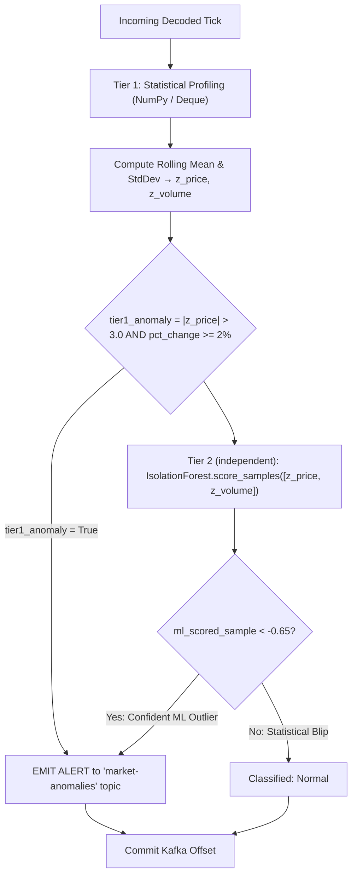

# Machine Learning Stream Inference: Concepts, Math & Architecture

> **Guide Purpose**: An intuitive, step-by-step primer on how real-time stream inference, rolling statistical windows, and unsupervised machine learning (Isolation Forest) detect financial anomalies in Gobbler.

---

## 1. The Core Problem: Why Real-Time Surveillance is Hard

In financial markets, anomalous events—such as **flash crashes**, **pump-and-dumps**, and **abnormal volume spikes**—unfold in milliseconds:

* **Traditional Batch Machine Learning**: Data is loaded into a data warehouse (e.g. Snowflake or BigQuery) at midnight, cleaned, and a model runs a batch script hours later. **By the time an alert triggers, millions of dollars have been lost.**
* **Real-Time Stream Inference (Gobbler)**: Every trade tick is evaluated **in-flight** as it arrives from the broker. The analytical engine must decide within **$< 15$ milliseconds**:
  1. *Is this price movement normal given the asset's recent behavior?*
  2. *Is the accompanying trading volume abnormally high?*
  3. *Should we trigger an emergency alert to market operators?*

---

## 2. Statistical Baseline: Rolling Windows & The Z-Score

Before deploying heavy machine learning algorithms, quantitative systems rely on **statistical profiling**.

### The Problem of "What is Normal?"
A price drop of $\$2.00$ might be a catastrophic **flash crash** for a $\$10.00$ stock (a 20% collapse), but totally normal noise for a $\$500.00$ stock (a 0.4% wobble). Furthermore, morning market opens are wild and volatile, while midday lulls are quiet.

Therefore, "normal" must be calculated **dynamically over a rolling recent window** (e.g., the last 100 ticks).

```text
Time Flow: ─────────────────────────────────────────────►
Historical Ticks:  [T-99, T-98, ..., T-2, T-1]  |  [Incoming Tick: T_0]
                   └───────────┬─────────────┘
                     Rolling Window (N=100)
                     Mean (μ), StdDev (σ)
```

---

### Step 1: The Rolling Mean ($\mu$)
The average price of the asset over the last $N$ ticks:

$$\mu = \frac{1}{N} \sum_{i=1}^{N} P_i$$

* **Intuition**: This is the current "gravity center" or baseline price of the stock.

---

### Step 2: The Rolling Standard Deviation ($\sigma$)
How spread out or volatile the prices have been inside that window:

$$\sigma = \sqrt{\frac{1}{N} \sum_{i=1}^{N} (P_i - \mu)^2}$$

* **Intuition**: 
  * If $\sigma$ is small (e.g., $\$0.05$), the stock has been trading tightly with very low volatility.
  * If $\sigma$ is large (e.g., $\$3.50$), the stock is swinging wildly.

---

### Step 3: The Z-Score ($Z$)
The Z-score measures **how many standard deviations an incoming price ($P_t$) sits away from the rolling mean ($\mu$)**:

$$Z = \frac{P_t - \mu}{\sigma}$$

* If $Z = 0$: The new price is exactly equal to the recent average.
* If $Z = +1.5$: The price is 1.5 standard deviations above the average (normal uptick).
* If $Z = -3.8$: The price plummeted 3.8 standard deviations below the average.

```text
                     Normal Distribution (The 68–95–99.7 Rule)
                                     
                                     │
                                   ┌─┴─┐
                                  ┌┘   └┐
                                 ┌┘     └┐
                                ┌┘       └┐
                              ┌─┘         └─┐
                      ┌───────┘             └───────┐
  ◄───[ ANOMALY ]─────┴──────────┬──────────┬───────┴─────[ ANOMALY ]───►
      (Z < -3.0)               -1σ   μ    +1σ             (Z > +3.0)
                       └────────── 68.2% ──────────┘
                └───────────────── 95.4% ─────────────────┘
         └──────────────────────── 99.7% ────────────────────────┘
```

#### Why the Threshold $|Z| > 3.0$?
In a normal distribution:
* **$99.73\%$** of all data points fall within $\pm 3\sigma$.
* A data point beyond $|Z| > 3.0$ has a probability of less than **$0.27\%$** (roughly a 1-in-370 occurrence). 
* When $|Z| > 3.0$, our detector flags a **statistical anomaly**.

---

## 3. Unsupervised ML: Isolation Forest

While Z-scores are fast and great for 1-dimensional price spikes, real fraud involves **multi-dimensional correlations** (e.g., Price AND Volume together).

### Why Unsupervised Learning?
In real trading, we do not have pre-labeled data telling us: *"Tick 42 was market manipulation, Tick 43 was legal"*. We must detect anomalies **without labels**.

### The Intuitive Analogy: The "Twenty Questions" Game
Imagine a crowd of 1,000 people standing in a room. 990 of them are clustered in the center chatting. 1 person is standing alone in the far corner wearing a scuba suit.

* If you play a game of "Twenty Questions" drawing random dividing lines across the room:
  * To isolate a **normal** person in the dense cluster, you have to draw **many lines** (15–20 questions).
  * To isolate the **outlier** standing in the corner, you only need **1 or 2 lines**!

```text
    Feature 2 (z_volume)
         ▲
   +54σ  │                                  ★ [ANOMALY: volume 20x spike + 15% crash]
         │                                    (Isolated in 1 cut!)
         │                     Cut 1 ─────────
         │
    +1σ  │      ●  ● ●●● ●
     0   │     ●●● ●●●●● ●●   ◄── Dense Normal Cluster centered at (0, 0)
    -1σ  │      ●  ●●●●  ●        (Needs 10+ random cuts to isolate)
         └───────────────────────────────────────► Feature 1 (z_price)
              -3σ    -1σ     0     +1σ    +3σ
```

### How `IsolationForest` Works Mathematically
1. The algorithm builds an ensemble of random decision trees (called **Isolation Trees** or *iTrees*).
2. For each tree, it picks a random feature (e.g., `z_volume`) and a random split value between that feature's min and max.
3. It recursively splits the data until every point is isolated in its own leaf node.
4. **Path Length $h(x)$**: The number of edges traversed from the root to isolate point $x$.
5. **Anomaly Score** (returned by `score_samples`):
   $$\text{score} = -2^{-\frac{E(h(x))}{c(n)}}$$
   * Short path (anomaly easily isolated) → score closer to $-1.0$.
   * Long path (deep in the cluster) → score closer to $-0.45$.

---

## 4. The Two-Tier Hybrid Architecture (Sub-15ms Guarantee)

Training an Isolation Forest on every single tick takes $\sim 50\text{ms}$—which is far too slow for high-frequency streaming.

To achieve **$< 15\text{ms}$ p99 latency**, we employ a **Two-Tier Architecture**:



#### Key Architectural Decisions

1. **Independent OR-Logic (Not a Cascade)**:
   The two tiers are **independent detectors** — either can fire without the other:
   ```python
   is_anomaly = tier1_anomaly or (ml_scored_sample < -0.65)
   ```
   * **Tier 1** catches: univariate price shocks ($|Z| > 3.0$ with $\geq 2\%$ price move).
   * **Tier 2** catches: multivariate co-movement anomalies — e.g., a volume-only spike with no significant price movement, which Tier 1 is blind to.

2. **`score_samples` vs. `predict` — Why the Continuous Score Wins**:
   * `model.predict(X)`: Binary output ($-1$ / $+1$). With `contamination=0.02`, it always labels the bottom $2\%$ of the training distribution as $-1$, even when no real anomalies were present during the training window (**Contamination Trap** — constant false positives on normal random-walk ticks).
   * `model.score_samples(X)`: Continuous float. Typical ranges:
     * $> -0.45$: Deep inside the normal cluster.
     * $-0.45$ to $-0.60$: Cluster boundary (borderline).
     * $< -0.65$: Isolated point — **genuine outlier**.
   * Using a calibrated threshold on `score_samples` decouples the anomaly decision from the `contamination` hyperparameter.

3. **Feature Normalization Before Fitting**:
   Raw `[price, volume]` features have incompatible scales. The forest is trained on **rolling Z-scores**:
   $$\text{features} = [z_{price},\ z_{volume}] = \left[\frac{P_t - \mu_P}{\sigma_P},\ \frac{V_t - \mu_V}{\sigma_V}\right]$$
   This collapses both axes to unit variance, centers the normal cluster at $(0, 0)$, and makes genuine outliers (e.g., $z_{price} \approx -6$, $z_{volume} \approx +54$) geometrically easy to isolate.

4. **Periodic Re-Fitting (Regime Adaptation)**:
   The model re-trains from the rolling window every `refit_interval=100` ticks, keeping the feature space aligned with the current market regime.

---

## 5. Efficient Data Structures: Why `collections.deque`?

In Python, choosing the right data structure for the rolling window is critical:

| Data Structure | Append Operation | Evict Oldest (Pop Left) | Memory Allocation |
| :--- | :--- | :--- | :--- |
| **Python `list`** | $O(1)$ amortized | **$O(N)$** (Shifts all items in memory) | Reallocates dynamically |
| **NumPy Array** | **$O(N)$** (Creates a whole new array) | **$O(N)$** | Fixed buffer |
| **`collections.deque(maxlen=N)`** | **$O(1)$** | **$O(1)$** (Automatic drop) | **Zero re-allocations (Circular buffer)** |

Using `collections.deque(maxlen=100)` gives us an in-memory circular buffer with **$O(1)$ constant time** updates. When full, adding tick 101 automatically discards tick 1 with zero memory overhead!

---

## 6. Critical Edge Cases to Guard Against

1. **The Cold Start Problem**:
   When the consumer first starts, the deque has 1, 2, or 5 ticks. With fewer than ~10 ticks, standard deviation is meaningless.
   * *Rule*: Do not score Z-scores until the window contains at least $N_{\text{min}}$ ticks (e.g., 20 ticks). The ML layer requires a stricter warm-up of at least 100 ticks before the first `.fit()` call.
2. **Zero Volatility ($\sigma = 0$)**:
   If a stock is halted or illiquid, 50 consecutive ticks might have the exact same price ($\$10.00$). The standard deviation is $0$.
   * *Price guard*: Floor `std_price_effective = max(σ_price, 0.01)` to prevent `ZeroDivisionError`.
   * *Volume guard*: A similar floor must be applied before normalizing volume: e.g., `max(σ_volume, 1.0)`. Without it, `history_normalized = (data - means) / stds` produces `nan` when all volumes in the window are identical, corrupting the Isolation Forest's training matrix.
3. **Regime Change (Market Drift)**:
   If an asset steadily trends from $\$30 \to \$40$ over an hour, a static baseline would keep alarming. A rolling window of size 100 naturally shifts its mean $\mu$ upward with the trend, avoiding false positives.
4. **Contamination Trap (`model.predict` vs `score_samples`)**:
   `IsolationForest(contamination=0.02).predict(X)` guarantees that **2% of the training distribution is labeled $-1$**, even when no real anomalies exist in the window. In a normal 100-tick random walk, this produces a constant stream of false positives on boundary ticks. The fix is to **not use `predict`** for the anomaly decision, and instead use `score_samples` with a calibrated threshold (e.g., $< -0.65$).
