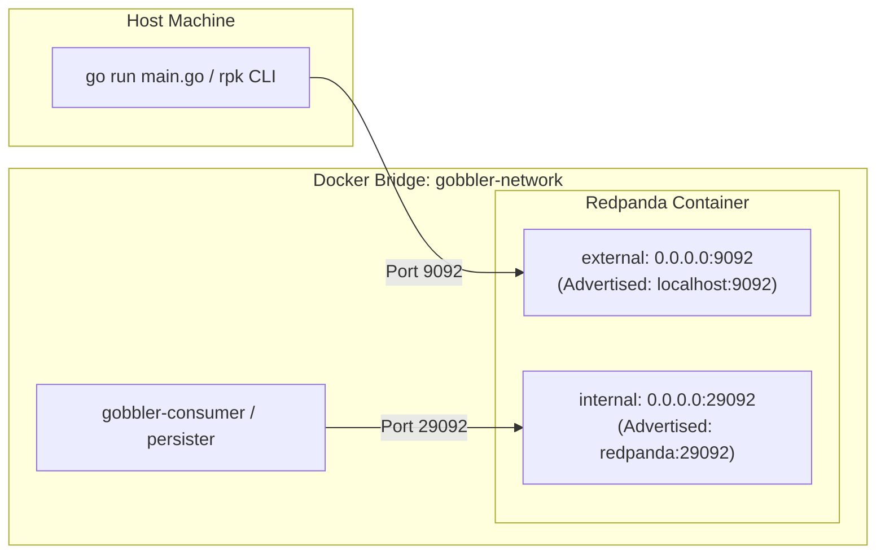

# Infrastructure-as-Code (IaC): Terraform & OpenTofu Guide

This document explains the concepts, operational mechanics, and architectural design for managing Gobbler's containerized infrastructure using **Terraform / OpenTofu**.

---

## 1. What is Infrastructure-as-Code (IaC)?

**Infrastructure-as-Code (IaC)** is the practice of provisioning and managing computing infrastructure using declarative configuration files rather than manual point-and-click consoles or imperative scripts.

### Declarative vs. Imperative
* **Imperative (e.g., Bash, CLI commands)**: You specify *how* to achieve a state (e.g., `docker run -d --name valkey -p 6379:6379 ...`). If you run the command twice, it errors because the container already exists.
* **Declarative (e.g., Terraform / OpenTofu)**: You specify *what* the end state should be (e.g., "there should be a Valkey container attached to `gobbler_net` exposing port 6379"). The engine compares your desired state with the actual infrastructure state and calculates the exact delta needed.

### Terraform & OpenTofu
* **Terraform**: The industry standard declarative IaC tool originally developed by HashiCorp.
* **OpenTofu**: An open-source, community-governed (Linux Foundation) fork created to preserve the MPL-2.0 license.
* **Compatibility**: Both tools utilize the exact same **HCL (HashiCorp Configuration Language)** syntax, state file semantics, and provider ecosystem (including the Docker provider). Configuration files written in `infra/` are 100% interoperable between `terraform` and `tofu`.

---

## 2. Core Concepts & Engine Lifecycle

```text
[ HCL Code (*.tf) ] ────► [ terraform plan ] ◄────► [ Docker Engine API ]
                                   │                           │
                                   ▼                           │
                        [ Execution Plan (Diff) ]              │
                                   │                           │
                                   ▼                           ▼
                        [ terraform apply ]  ─────► [ Real Infrastructure ]
                                   │
                                   ▼
                        [ terraform.tfstate ]
```

### 1. The State File (`terraform.tfstate`)
* Terraform maintains a state file tracking the metadata and IDs of every resource it provisions.
* State enables drift detection: during `plan` or `apply`, Terraform queries the target platform (e.g., Docker daemon) to see if actual state matches the recorded state, catching manual deletions or modifications.

### 2. Directed Acyclic Graph (DAG) & Dependency Ordering
* Terraform analyzes references between resources to construct an execution graph.
* If a container references `docker_network.gobbler_network.id`, Terraform knows it must create the network *before* attempting to start the container.
* Explicit dependencies can be enforced using the `depends_on = [...]` meta-argument.

### 3. The Lifecycle Commands
1. **`init`**: Reads `versions.tf`, downloads required provider plugins into `.terraform/`, and sets up the state backend.
2. **`validate` / `fmt`**: Checks HCL syntax, argument types, and canonical code formatting.
3. **`plan`**: Compares code against actual state, showing an execution preview (`+` create, `~` update in-place, `-` destroy).
4. **`apply`**: Executes the planned graph against the target provider.
5. **`destroy`**: Reverses the dependency graph, cleanly terminating and removing managed infrastructure.

---

## 3. The Docker Provider (`kreuzwerker/docker`)

The `kreuzwerker/docker` provider communicates directly with the local Docker daemon via the Unix socket (`unix:///var/run/docker.sock`).

### Key Resource Types
| Resource | Purpose | Gobbler Implementation |
| :--- | :--- | :--- |
| **`docker_network`** | Creates user-defined bridge networks. | Provisions `gobbler-network` with automatic container-to-container DNS resolution (`redpanda`, `questdb`, `valkey`). |
| **`docker_volume`** | Provisions persistent named storage volumes. | Backs QuestDB root data (`questdb_data`) so table partitions survive container recreation. |
| **`docker_image`** | Manages container image pulls and cache integrity. | Pulls official images (`redpandadata/redpanda`, `valkey/valkey`, `questdb/questdb`) with `keep_locally = true`. |
| **`docker_container`** | Lifecycle management of running containers. | Declares ports, environment variables, mounts, health checks, and entrypoints. |

---

## 4. Gobbler Modular Architecture (Option C)

In `infra/`, we separate foundational **data plane backbones** from transient **application microservices**:

```text
infra/
├── versions.tf        # Provider requirements & engine constraints (kreuzwerker/docker >= 3.0.2)
├── variables.tf       # Configurable inputs (ports, image tags, feature toggles)
├── main.tf            # Core network (gobbler-network) and storage volume (questdb_data)
├── auxiliary.tf       # Stateful engines: Redpanda, Valkey, and QuestDB
├── workloads.tf       # Microservices: Gateway, Persister, and Consumer
└── outputs.tf         # Exported connection URLs and host:port endpoints
```

### The Feature Toggle Pattern (`enable_microservices`)
In `infra/variables.tf`:
```hcl
variable "enable_microservices" {
  description = "Option C toggle: when false (default), provisions only the auxiliary data plane; when true, deploys custom Go/Python microservices in Docker"
  type        = bool
  default     = false
}
```

In `infra/workloads.tf`:
```hcl
resource "docker_container" "gateway" {
  count = var.enable_microservices ? 1 : 0
  name  = "gobbler-gateway"
  image = "gobbler-gateway:latest"
  # ...
}
```
* **Default Mode (`false`)**: Spins up Redpanda, Valkey, and QuestDB. Developers can edit Go/Python code locally and run against the live data plane.
* **Full-Stack Demo Mode (`true`)**: Spins up the entire distributed surveillance platform with a single flag (`terraform apply -var="enable_microservices=true"`).

### Kafka Networking & The Dual-Listener Strategy

Kafka and Redpanda clients connect in two steps:
1. **Bootstrap Phase**: The client connects to the initial broker address (e.g. `redpanda:29092` or `localhost:9092`) and requests cluster metadata.
2. **Metadata Reconnection**: The broker responds with the **Advertised Address** for partition leaders. The client then disconnects from the bootstrap socket and initiates all data production/consumption to that advertised address.



If Redpanda only advertised `localhost:9092`, containerized workloads on `gobbler-network` would attempt to reconnect to `localhost` inside their own network namespaces and fail with `Connection refused`.

To solve this, Redpanda is configured with **dual named listeners**:
* **Internal Listener (`internal://0.0.0.0:29092`)**: Advertised as `internal://redpanda:29092` for microservices within the Docker network.
* **External Listener (`external://0.0.0.0:9092`)**: Advertised as `external://localhost:9092` and published to the host for local development, tests, and the `rpk` CLI.

---

## 5. CLI Operational Cheat Sheet

### Initializing the Workspace
```bash
cd infra
terraform init
```

### Formatting & Validating Configuration
```bash
terraform fmt -check
terraform validate
```

### Planning & Reviewing Changes
```bash
# Preview changes for auxiliary data plane only (default)
terraform plan

# Preview changes with all application microservices enabled
terraform plan -var="enable_microservices=true"
```

### Applying Infrastructure
```bash
# Spin up auxiliary services (Redpanda, Valkey, QuestDB)
terraform apply -auto-approve

# Spin up full distributed stack
terraform apply -var="enable_microservices=true" -auto-approve
```

### Inspecting Outputs
```bash
terraform output
# Displays:
# kafka_broker    = "localhost:9092"
# questdb_web_url = "http://localhost:9000"
# valkey_endpoint = "localhost:6379"
```

### Tearing Down Infrastructure
```bash
# Destroy managed containers and networks (preserves volumes unless configured)
terraform destroy -auto-approve
```

---

## 6. Cloud & Kubernetes Migration Path

Understanding this IaC architecture bridges the gap between local Docker and production cloud platforms:

1. **Provider Swapping**: In AWS/GCP, `kreuzwerker/docker` resources are replaced by cloud resources (e.g., `aws_msk_cluster` for Kafka, `aws_elasticache_cluster` for Valkey, `aws_ecs_service` for containers).
2. **Kubernetes Integration (Step 5)**: In the next step, our `auxiliary.tf` provides the persistent data stores, while application microservices transition from `docker_container` resources to declarative Kubernetes Deployments, Services, and Horizontal Pod Autoscalers inside a **Kind** cluster.
